<!-- Editorial reference for the Tree Systems case study. Edit this file first; apply approved edits to TreeSystemsCaseStudy.jsx. The website does not load this Markdown automatically. Notes inside comments describe existing UI behavior and are not page copy. -->

# Tree Systems - Designing Unfamiliar Systems

A procedural tree system and an authoring tool for *Woods*, built in Godot with C# and shaders.

When this project was started, the goal was to create a basic Tree using AI. However, my experience developing systems quickly pushed me to use the AI to create a Tree System rather than requesting
for a completely usable tree mesh. I find that requesting for the final product is the trap that results in "AI-Slop". The proccess of creation is itself an art, and rapidly creating the tools with AI helps you
engage in that proccess much sooner.

In short, AI helps build the machinery; the tool gives me a way to inspect it and make the visual decisions myself.

## Preparation

It's always good to prepare yourself before engaging with a task. For this project, I used Claude to source information on how tree-systems are created online. For myself, I searched for inspiration on what
distinct look of trees I wanted to be able to depict with the potential system I will be creating. The goal was to create a Tree System that works with Cell Shading. 

I gathered references from paintings, 3D models, trees in games, and sketches. These are just a few examples from that broader collection.

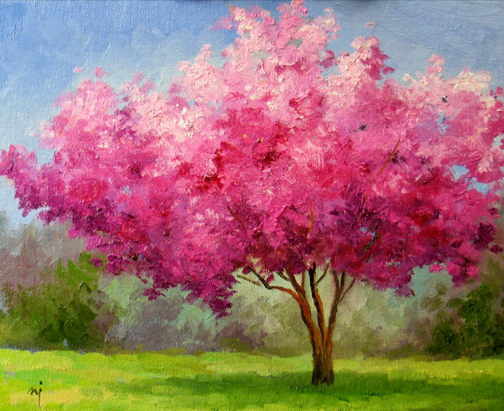

*Painted canopy masses and color.*

*Branching and an open silhouette.*

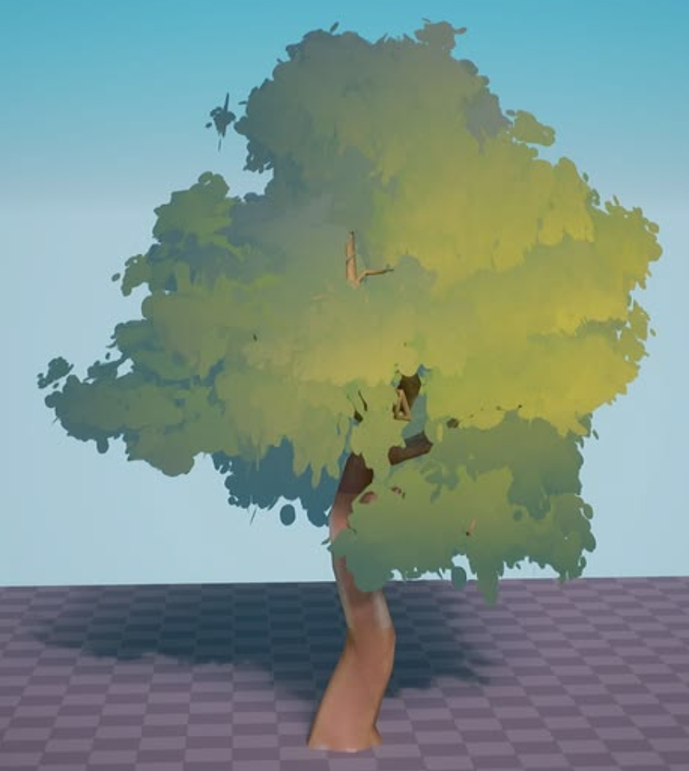

*Foliage grouped into light and shadow.*

## Turning the References into Branching Rules

From inspiration to rules

The references gave me a visual direction. A profile gave me a way to turn that direction into rules I could adjust.

To work toward the shapes in the references, I needed control over the structure underneath the leaves. Branch length, spread, taper and bend let me work on the silhouette directly. Saving those decisions in a profile also meant I could explore different individuals without losing the character of a tree type.

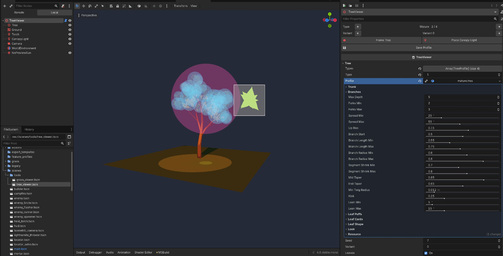

*Mature profile · branch rules in the Godot inspector beside their generated result*

### Tree structure dictates a lot of the look

Most trees follow the same structure with variations on some parameters that gives them their final look. All we do is try to capture what those parameters are, and place them in the Godot Editor.

`BareTreeMesh` builds a tapering trunk and branching limbs. Forks become thinner and shorter until the depth or minimum twig radius ends their growth. Nearby twig tips are then grouped into puffs, which are filled with leaf cards. Most trees follow the same rules due to the underlying physics in the real world that promotes this structure. With that said, we're also *free* to break those rules as much as we want since we dictate what the parameters are. 

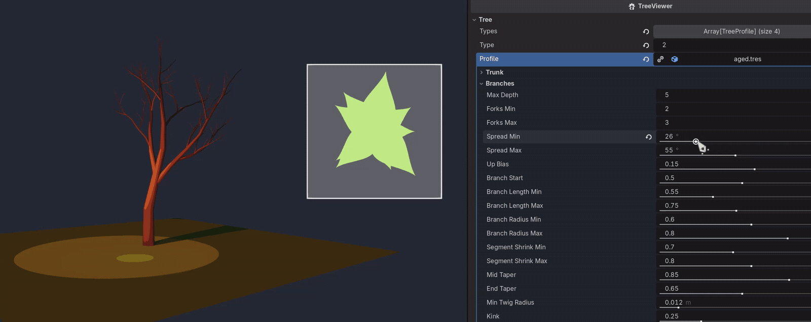

*Adjusting the branch profile live · Leaves hidden to reveal changes to the tree’s structure*

The geometry and shading have different jobs. Cards supply the leafy silhouettes; puff and crown volumes supply the smooth shading directions. That separation makes it possible to tune a crisp leaf outline without forcing every card to look like a separately lit flat surface.

<!-- Technical detail: hidden in Simplify mode. -->

More detail has a cost. Fork depth multiplies the amount of branching, and card density increases foliage geometry. In the forest, a limited set of generated meshes is reused with different rotations and scales, rather than building a unique mesh for every placed tree.

<!-- End technical detail. -->

## Understanding What Makes the Foliage Read as a Tree

The goal

Controlling the branches gave me a structure to work with. Understanding the foliage meant making its hidden shapes visible too.

Adding leaves brings the silhouette and the shading together, which makes it harder to tell what needs adjusting. I needed to see how the smaller foliage clusters contributed to the whole canopy. The viewer exposes those relationships through debug overlays. Below, compare young, mature and aged trees with the overlays on and off to see the construction behind the finished appearance.

<!-- Interactive tree gallery: Young, Mature and Aged; variants 0–2 for each, with normal/debug toggle, playback, and enlargement. Keep this component at this position. -->

**Puffs · local foliage clusters**

Nearby twig tips share a puff. The shader uses its sphere as a stand-in surface for shading, so many flat leaf cards read as one rounded cluster.

<!-- Simplified alternative: The small blue spheres show the groups of leaves. Each group is lit as one rounded volume. -->

**Crown · the overall canopy**

A larger stand-in sphere supplies the crown’s overall shading direction. Crown influence blends that direction with each puff’s, tying the clusters into a single canopy.

<!-- Simplified alternative: The larger pink sphere gives the whole canopy a shared direction for its shading. -->

**Leaf Shape · the card’s cut-out**

The enlarged green shape shows one leaf card up close. Its outline can be judged separately from the thousands of small shapes that make up the tree; the square marks where the card clips it.

### Turning a Visual Question into Something I Can Inspect

This gave me a way to connect a visual judgment to a part of the implementation. If a canopy feels too round, I can inspect puff placement and crown influence. If its edge feels wrong, I can look at the leaf shape. Those are specific questions I can investigate with AI, using the preview to judge the answer.

## Finding the Look through Experimentation

With those relationships visible, I could use the viewer to explore the look itself. Instead of describing a finished tree in another prompt, I could adjust one part, watch the result, and decide what to change next. The canopy and the individual leaf needed attention at different scales.

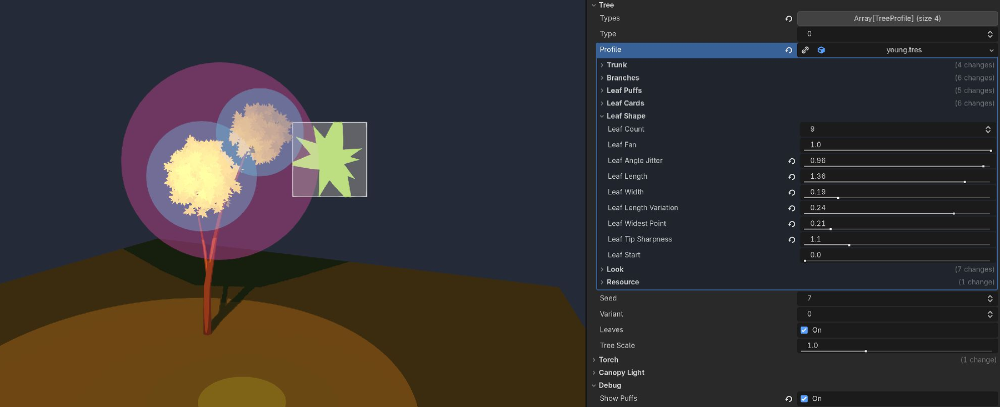

*Leaf Shape · the profile’s controls beside the enlarged card preview*

### Adjusting the Fullness of the Canopy

At the canopy scale, I could experiment with how foliage gathers around the branches. In this recording, changing puff spacing and radius changes the distribution and fullness live. That feedback lets me judge the shape while working on it, rather than waiting for a new generated result.

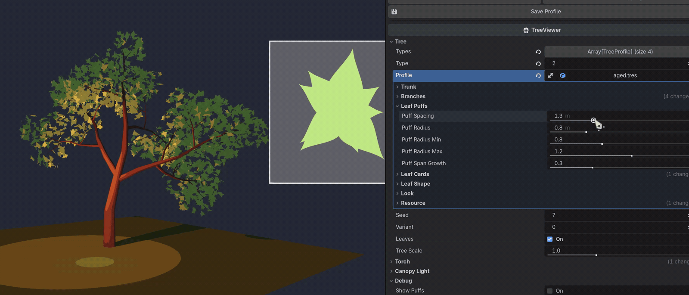

*Shaping the canopy live · adjusting leaf puff spacing and radius*

### Looking Closer at a Single Leaf

A leaf is too small to judge reliably in a full tree. The enlarged preview makes width, fan, tip sharpness and the position of the widest point visible at a useful scale. It uses the same leaf-shape shader include as the foliage, so the preview and the tree share the actual cut-out logic.

Together, these views gave me a practical way to work from the references: adjust the larger masses, inspect the smaller shapes, and compare the whole tree again. AI helped with the implementation, while the tool let me make those visual decisions myself.

<!-- Technical detail: hidden in Simplify mode. -->

**What each part of the profile controls**

| Part | Parameters | Visual decision |
| --- | --- | --- |
| Trunk & branches | Length, thickness, fork count, spread, taper and bend. | The silhouette and structure of the tree. |
| Leaf puffs | Group nearby twig tips and control each cluster’s size. | Where foliage gathers, and how full it feels. |
| Leaf cards | Size, density, scatter and camera-facing behavior. | How small flat surfaces fill out each puff. |
| Leaf shape | Leaf count, fan, width, widest point and tip sharpness. | The cut-out silhouette on each card. |
| Look | Color, shading bands, variation and crown influence. | How those shapes read under the game’s lighting. |

<!-- End technical detail. -->

## Taking the Trees Back into Woods

A tree in the viewer is only part of the goal; it also has to belong in Woods. The saved profiles connect those two contexts. Young, mature and aged trees, along with shrubs, have their own profiles, while seeds and variants produce different individuals within each type.

The viewer edits the same `TreeProfile` resources that the forest and bushes use. Saving a profile writes its `.tres` file. The game builds its trees from those settings, so there is no separate set of tree values to copy across by hand.

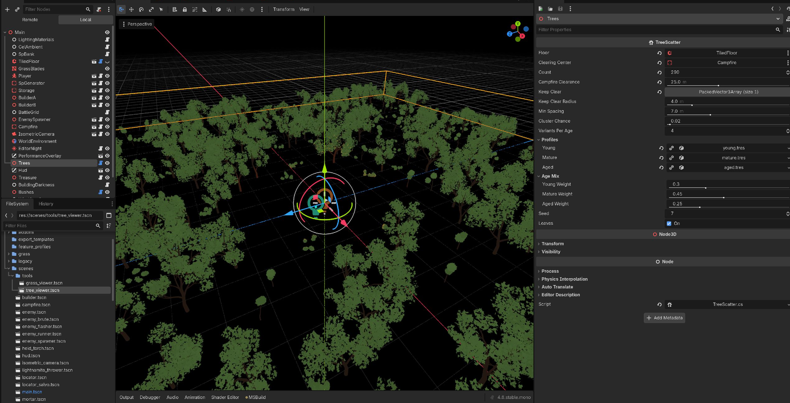

*Game scene · TreeScatter uses young.tres, mature.tres and aged.tres to populate the forest*

The boundary

Tree settings belong to the profile. Camera position, preview lighting and debug overlays belong to the viewer.

The torch, canopy light and ambient fill help judge the tree under the game’s night lighting. They stage the preview; they do not become part of the tree recipe. That keeps an experiment with the camera or lighting separate from a change to the trees themselves.

Resource bindings listen for profile changes, and tree regeneration is deferred so a slider can request multiple changes while the viewer rebuilds at most once per frame. The forest also tracks profile changes while its scene tab is away and rebuilds when it returns.

## What I Can Make with the System So Far

These are some of the trees and shrubs I have achieved using the system. The earlier controls come together here: branching gives each plant its structure, while leaf shape, foliage distribution and color give it a different character.

Seeing these results beside each other brings the project back to the references I started with. The system is still in its infancy, but I now have a way to explore those ideas myself and see how the trees read both in the viewer and in Woods.

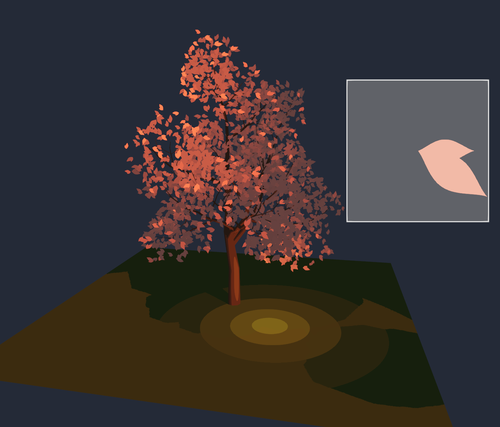

*Warm foliage · a branching canopy built from a single-leaf shape*

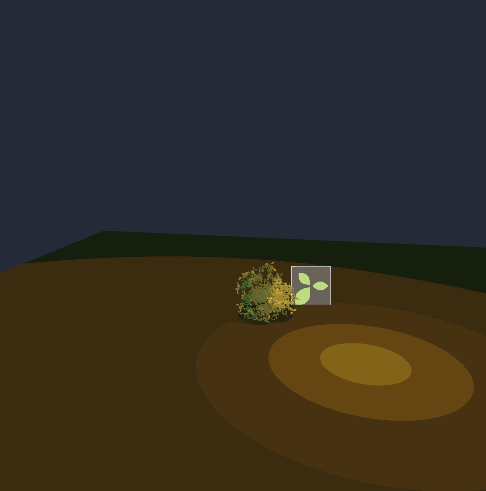

*Compact shrub · a different scale and a three-leaf card*

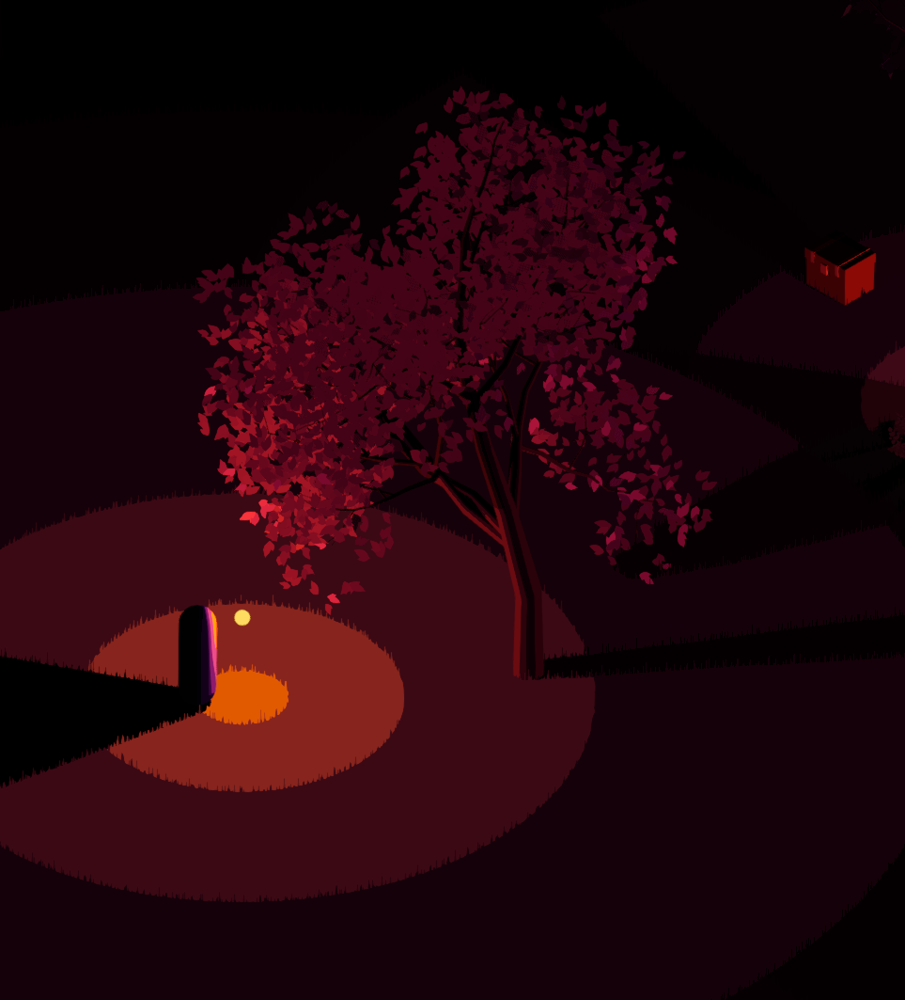

*In Woods · seeing the tree under the game’s night lighting*

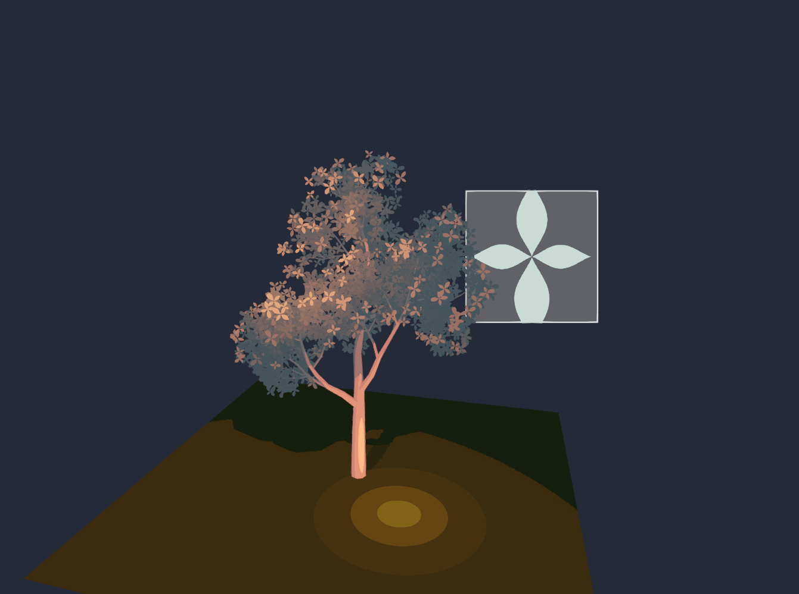

*Another look · a pale trunk and a four-leaf silhouette*

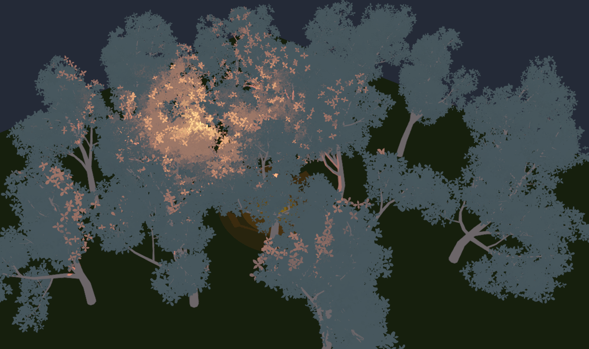

*Together as a forest · judging overlapping canopies, variation and light*

<!-- Small 400px-wide, 15 fps, lazy-loaded, enlargeable GIF preview. -->

*Flares in Woods · trees and foliage under moving light*

## What I Want to Explore Next

These results give me a starting point to build on. The next features I want to explore are:

- **Flowers.** Add flowers to the trees.
- **Better light interaction.** Improve how the trees respond to light.
- **Falling leaves.** Explore falling leaves through a shader.

## What This Changed about Working with AI

The project began with the goal of making a tree using AI. The more useful result was a way to keep designing trees. Research gave me concepts to work with; branch controls, debug volumes and leaf previews made those concepts something I could inspect and change.

The working loop became more concrete: choose a visual question, expose the part of the system behind it, and judge the change in the viewer. The Look controls bring color and shading into that same loop, alongside the structure and leaf shape.

*Inspect and judge · appearance controls and debug volumes share the same editor view*

Visual judgment still needs technical checks. Woods includes verification scripts for foliage shadows, lighting materials and wind behavior. For example, the foliage-shadow check compares a lit scene with the same scene under a solid blocker. That tests a rendering behavior separately from whether the tree looks good. These are checks in the project, not benchmark results claimed here.

### Conclusions

The references remain a direction to work toward, and the system, which is pretty much still in its infancy, gives me a way to keep working toward it. 

I can change the rules, judge the result and carry those creative decisions myself. 

> “Build the system that makes the output.”

---

## Media reference (editorial only)

Opening/project-card preview: [seven-second gameplay GIF](../gifs/tree-systems.gif).

Interactive gallery assets:

| Age | Variant | Normal appearance | Debug overlays |
| --- | --- | --- | --- |
| young | 0 | [Image](../gifs/tree-viewer-young-0-clean.png) | [Image](../gifs/tree-viewer-young-0.png) |
| young | 1 | [Image](../gifs/tree-viewer-young-1-clean.png) | [Image](../gifs/tree-viewer-young-1.png) |
| young | 2 | [Image](../gifs/tree-viewer-young-2-clean.png) | [Image](../gifs/tree-viewer-young-2.png) |
| mature | 0 | [Image](../gifs/tree-viewer-mature-0-clean.png) | [Image](../gifs/tree-viewer-mature-0.png) |
| mature | 1 | [Image](../gifs/tree-viewer-mature-1-clean.png) | [Image](../gifs/tree-viewer-mature-1.png) |
| mature | 2 | [Image](../gifs/tree-viewer-mature-2-clean.png) | [Image](../gifs/tree-viewer-mature-2.png) |
| aged | 0 | [Image](../gifs/tree-viewer-aged-0-clean.png) | [Image](../gifs/tree-viewer-aged-0.png) |
| aged | 1 | [Image](../gifs/tree-viewer-aged-1-clean.png) | [Image](../gifs/tree-viewer-aged-1.png) |
| aged | 2 | [Image](../gifs/tree-viewer-aged-2-clean.png) | [Image](../gifs/tree-viewer-aged-2.png) |
